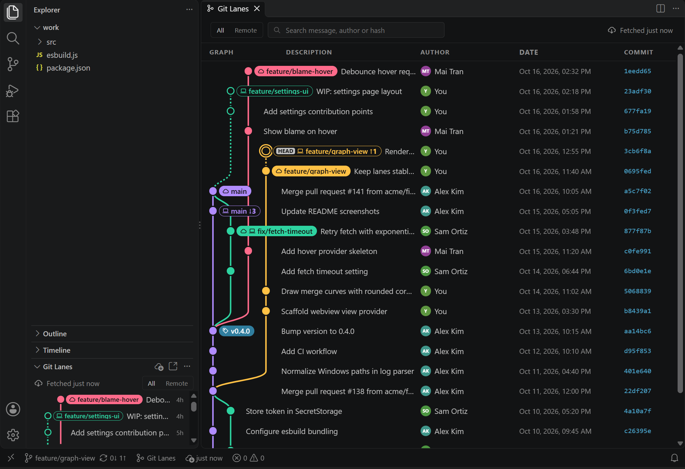

<p align="center"></p>

<h1 align="center">Git Lanes</h1>

<p align="center">A clean branch graph for VS Code: every branch in its own lane, the default branch on the left, remote and local at a glance.</p>



## Install

- **From VS Code:** open the Extensions view (`Ctrl+Shift+X`), search for **Git Lanes**, and click **Install**. Or run `ext install lesyhau.git-lanes` from the Quick Open (`Ctrl+P`).
- **From a VSIX:** download `git-lanes-<version>.vsix` from [Releases](https://github.com/lesyhau/git-lanes/releases), then run **Extensions: Install from VSIX…** in VS Code.

Open a folder that is a git repository. The **Git Lanes** view appears at the bottom of the Explorer, under Outline and Timeline. Click **Git Lanes** in the status bar to open the full graph in an editor tab.

## Features

- **Default branch on the far left.** `origin/HEAD` decides which branch that is (falling back to `main`, `master`, `trunk`, `develop`). The `gitLanes.defaultBranch` setting overrides it.
- **Every branch keeps its own vertical lane**, placed by three rules:
  - A branch always branches off to the **right** of the branch it starts from.
  - A branch always merges into a branch on its **left**. The one exception is a branch's own parent merged back into it ("sync" merges).
  - Each branch takes the **lowest lane** these rules allow that is free for its whole lifetime, so lanes are reused and no space is wasted.

  Among the arrangements that follow these rules, the solver picks the one with the fewest crossings, then the fewest lanes, then the shortest jumps.

  Some crossings can't be avoided: two branches that overlap in time without one containing the other always cross once.
- **Smooth, consistent curves.** Every branch-off and merge is the same S-curve, exactly one row tall: just above the parent for a branch-off, just below the merge commit for a merge. Curves that fan out of one commit nest instead of crossing.
- **The graph takes only the room it needs.** Each row's message starts right after the lines passing through that row.
- **Remote first, local at a glance.**

  | Looks like | Means |
  | --- | --- |
  | Solid badge, cloud icon | Remote branch |
  | Outlined badge, laptop icon | Local branch (`↑` ahead / `↓` behind its upstream) |
  | Solid badge, both icons | Local and remote branch at the same commit |
  | Filled dot, solid line | Commit on a remote |
  | Hollow dot, dashed line | Local-only commit (not pushed) |
  | Ring around the dot, `HEAD` tag | Checked-out commit |

  Remote branches are placed first. Local-only branches fill the lanes that are left. **All / Remote** hides local-only work without moving any lane.
- **Branch and tag names sit next to the branch's latest commit dot.**
- **Fetch** from the cloud icon in the view title, the "Fetched 2 min ago" status at the top of the graph (click it), or the status bar. While fetching, the icon turns into a spinner and the status reads "Fetching…".
- **Git Lanes button in the status bar** opens the full graph in the editor area, for big repositories where the sidebar is cramped. The view's "open in editor" button does the same.
- **The editor tab** shows a wider table with Description, Author, Date and Commit columns, plus search.
- **Commit details** open in an editor tab: changed files (click one for a diff), parents, refs, and Checkout, Create Branch, Copy Hash and Push (for local-only commits). Right-click a commit in the graph for the same actions.

## Automatic fetch

On by default (`gitLanes.autoFetch.enabled`). A fetch runs:

| When | Only if the last fetch is older than |
| --- | --- |
| The graph becomes visible | 1 min |
| The VS Code window regains focus | 2 min |
| ~3 s after local git activity (commit, checkout, branch or tag change) | 30 s |
| On an interval, while the window is focused and the graph is visible | `gitLanes.autoFetch.intervalMinutes` (5) |

Automatic fetches never run more than once every 30 s, and they never show a credential prompt.
- After a failure, it waits 1, 2, 4 … up to 30 minutes before trying again.
- When you're offline, it retries every 5 minutes.
- When the remote needs you to sign in, automatic fetching pauses until a manual **Fetch** succeeds. A manual fetch that needs sign-in uses VS Code's Git sign-in.

## Settings

| Setting | Default | |
| --- | --- | --- |
| `gitLanes.autoFetch.enabled` | `true` | Automatic fetching |
| `gitLanes.autoFetch.intervalMinutes` | `5` | Interval fetch period |
| `gitLanes.autoFetch.onWindowFocus` | `true` | Fetch when the window regains focus |
| `gitLanes.autoFetch.onLocalActivity` | `true` | Fetch after local git activity |
| `gitLanes.fetch.prune` | `true` | Remove remote-tracking branches deleted on the remote |
| `gitLanes.defaultBranch` | `""` | Branch pinned to the left lane |
| `gitLanes.maxCommits` | `400` | Commits per batch ("Load more" loads the next batch) |
| `gitLanes.laneColors` | `[]` | Custom lane colours, used in order |

## Contributing

Issues and pull requests are welcome at [github.com/lesyhau/git-lanes](https://github.com/lesyhau/git-lanes).

## Development

Requires Node.js 20+ and git.

```sh
npm install
npm run build      # dist/extension.js + dist/webview/*.js
npm test           # layout engine, git reader (on a temp repo), fetch policy
npm run typecheck
npm run package    # git-lanes-<version>.vsix
```

Press **F5** in VS Code to open an Extension Development Host.

How it is organised:

- `src/git/reader.ts`: reads refs, remotes, HEAD and `git log --date-order`, and parses commit details.
- `src/graph/chains.ts`: splits history into first-parent chains (one per branch). Merged-and-deleted branches get their own chains.
- `src/graph/layout.ts`: the lane solver.
  - It derives the "right of" rules from branch-offs and merges.
  - It places chains in a priority order, each in the lowest lane allowed and free.
  - It scores each layout by crossings, width, jump length and moved branches.
  - With few branches it tries every valid order. With many, it repairs crossings one by one, then narrows the graph, within a time budget.
- `src/graph/model.ts`: builds badges, local-only flags and the default branch, and produces the drawable model.
- `src/fetch/policy.ts`: decides when to auto-fetch.
- `src/controller.ts`: repository selection, refresh on ref changes, fetching and the status bar.
- `src/webview/*`: the graph renderer (sidebar and editor tab) and the commit details page.

## Releasing

1. Bump `version` in `package.json` and add an entry to `CHANGELOG.md`.
2. Commit, then tag and push: `git tag v0.2.0 && git push origin v0.2.0`.

The **Release** workflow then tests and packages the extension, attaches the `.vsix` to a GitHub Release, and publishes it:
- to the VS Code Marketplace when the repository has a `VSCE_PAT` secret;
- to Open VSX (VSCodium, Cursor and other editors) when it has an `OVSX_PAT` secret.

## License

[MIT](LICENSE)
